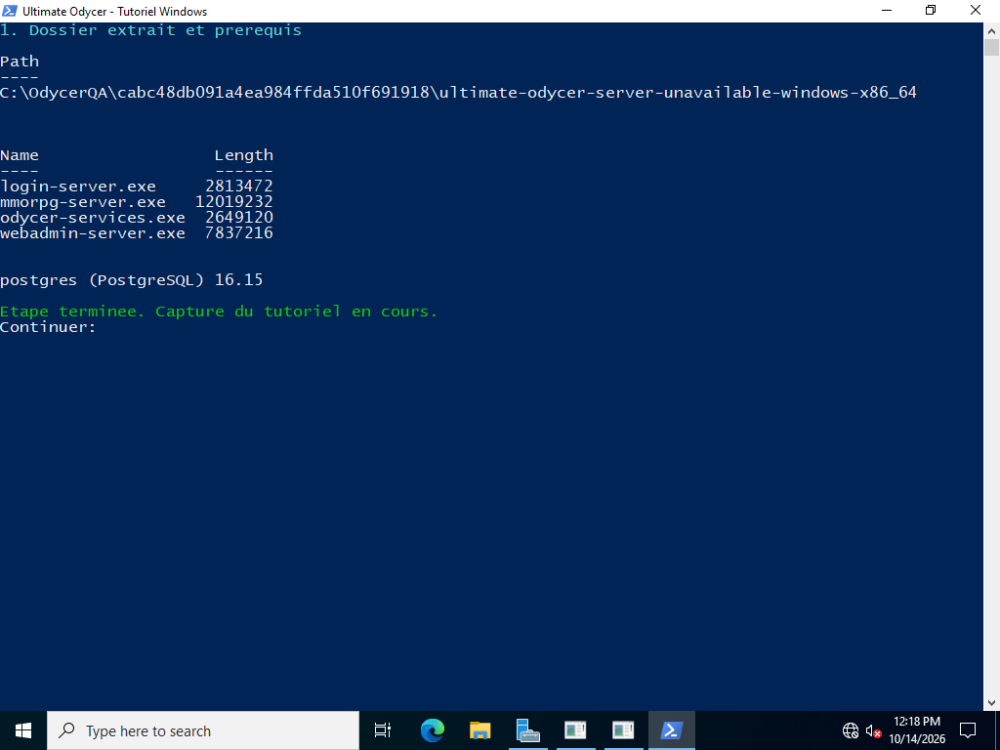
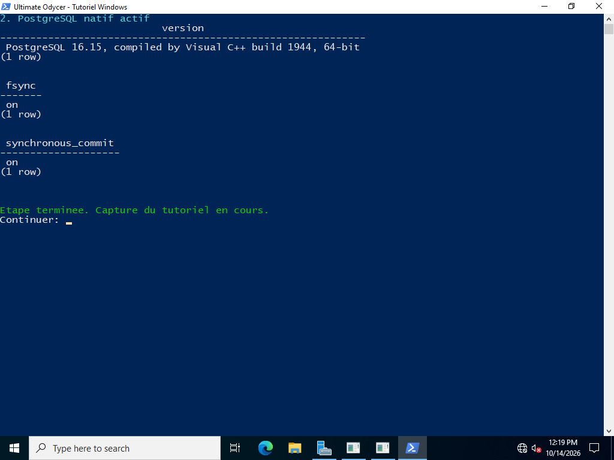
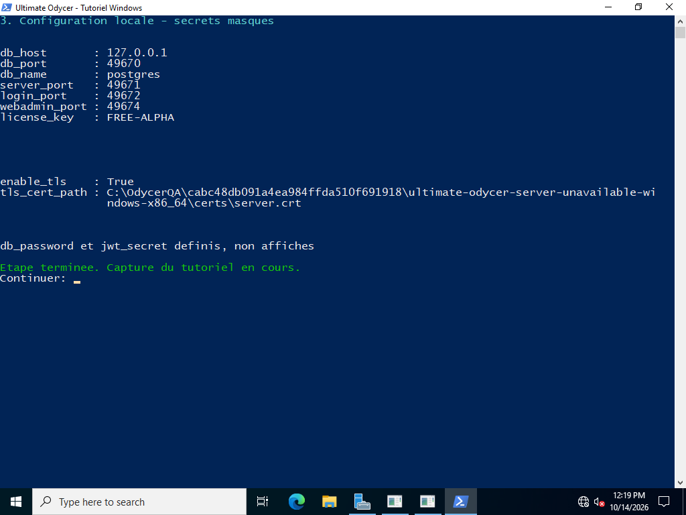
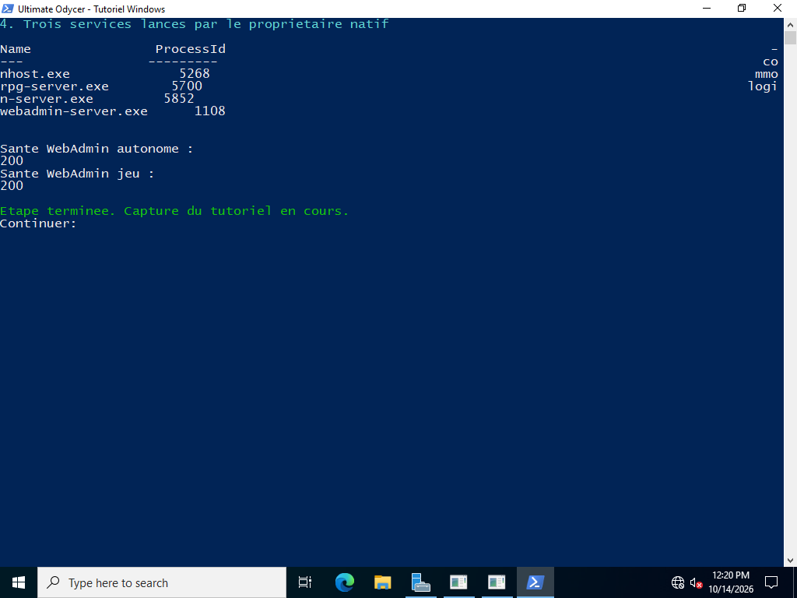
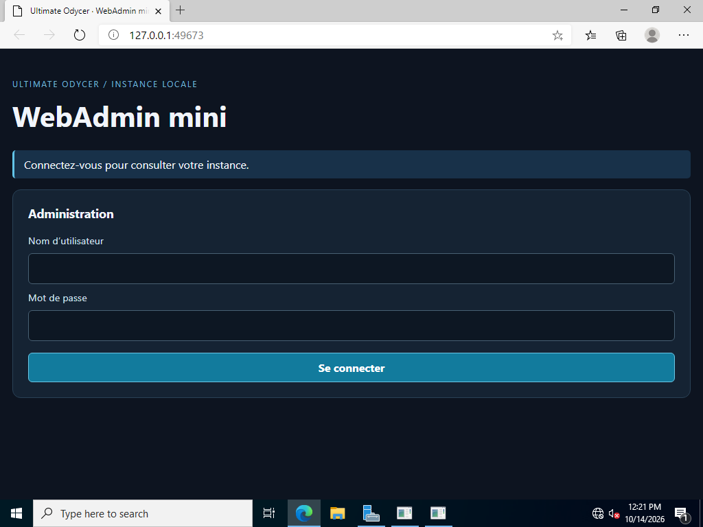
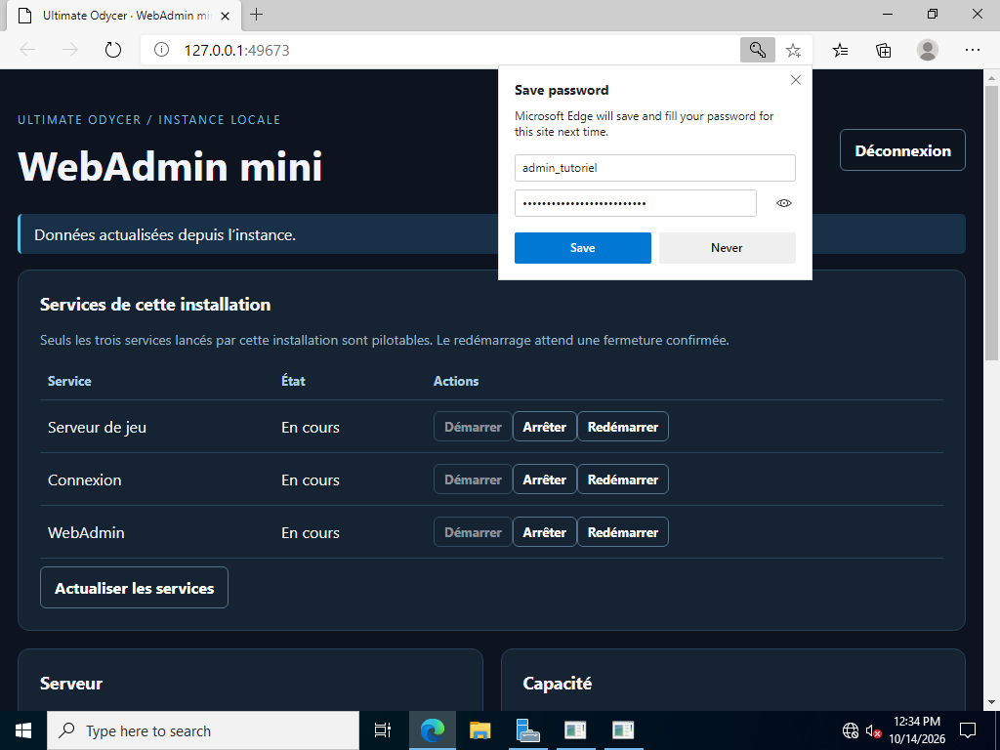
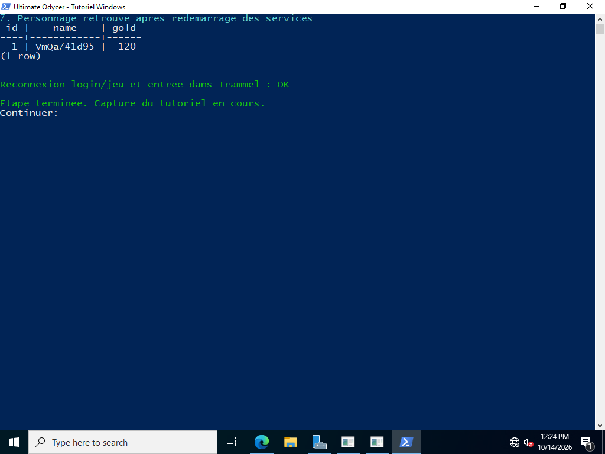
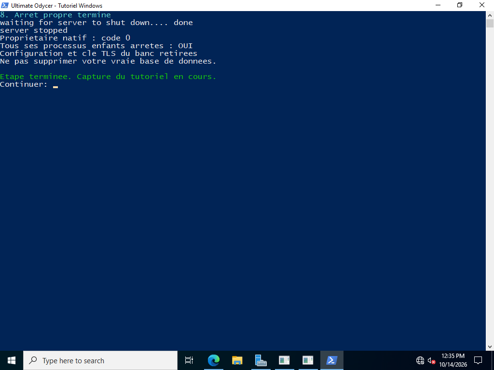

# Start Ultimate Odycer on Windows — illustrated local tutorial

**Observed qualification, 14 October 2026.** Eight real screenshots show Windows
Server 2022 Datacenter Evaluation, build 20348.169, with native PostgreSQL 16.15.
This is a local setup path for a matching, privately supplied qualification
archive. The public server release remains **unavailable**. If you have not
received that archive, read the guide and prepare prerequisites, then stop
before running the server. Check the [official release page](https://www.ultimateodycer.com/releases/).

The [full French illustrated guide](../../assets/windows-startup-20261014/TUTORIEL-WINDOWS.html)
is self-contained. The [offline download pack](../../assets/windows-startup-20261014/tutoriel-odycer-windows.zip)
contains the guide, eight images and four PowerShell scripts. These downloads
contain documentation and setup helpers, not the proprietary server executable.

## 1. Prepare a new local directory

Use a new `C:\Odycer` directory. Put the four tutorial scripts in
`C:\Odycer\tuto`, extract the matching server into `C:\Odycer\serveur`, and
extract the PostgreSQL 16.15 Windows x64 binary ZIP into `C:\Odycer\postgres`.
Keep the ZIP's `pgsql` subdirectory. PostgreSQL also needs its Microsoft Visual
C++ x64 runtime; the observed fixture used app-local MSVC 14.44.35112 DLLs beside
the PostgreSQL binaries. The server archive already includes its own client
DLLs; it does not include the PostgreSQL server.

Use the [official EDB binary downloads](https://www.enterprisedb.com/download-postgresql-binaries)
and [Microsoft runtime documentation](https://learn.microsoft.com/en-us/cpp/windows/latest-supported-vc-redist?view=msvc-170).
The binary ZIP/app-local runtime profile was exercised; installer wizards were
not. Redis is optional for this path.

Open two Windows PowerShell windows. If needed, launch each with
`powershell.exe -NoProfile -ExecutionPolicy Bypass`; this affects that process
only. The scripts use `Read-Host -AsSecureString`, which is available in Windows
PowerShell 5.1. The separate Docker guide has different PowerShell requirements.

In the first window:

```powershell
$server = 'C:\Odycer\serveur'
$pgBin = 'C:\Odycer\postgres\pgsql\bin'
$pgData = 'C:\Odycer\pgdata'
$tuto = 'C:\Odycer\tuto'
Get-ChildItem "$server\bin" -Filter *.exe | Select-Object Name, Length
& "$pgBin\postgres.exe" --version
```



The temporary directories and automatically chosen ports in the screenshots
belong to the fixture. Use your own paths above. Check the server archive's
SHA256 against the value delivered with your matching private kit. The observed
archive hash was `262ac6e29408f8df48ba31c86b36c846fe7bb26799c140eff504169e12b891d9`.
It carries a private qualification signature, not publicly trusted code signing.

## 2. Initialize PostgreSQL once

Use a fresh data directory. Choose a PostgreSQL password when `-W` prompts:

```powershell
& "$pgBin\initdb.exe" -D $pgData -U postgres --auth=scram-sha-256 --no-locale --encoding=UTF8 -W
if ($LASTEXITCODE -ne 0) { throw 'PostgreSQL initialization failed' }
& "$pgBin\pg_ctl.exe" -D $pgData -l 'C:\Odycer\postgres.log' -o '-h localhost -p 15432' -w -t 30 start
if ($LASTEXITCODE -ne 0) { throw 'PostgreSQL startup failed' }
& "$pgBin\psql.exe" -X -h localhost -p 15432 -U postgres -d postgres -c 'SELECT version(); SHOW fsync; SHOW synchronous_commit;'
```

Expect version 16.15, `fsync = on` and `synchronous_commit = on`.
Do not run `initdb` again on an existing cluster.



## 3. Create local TLS and configuration

Copy the four scripts from the download pack to your tutorial directory:

```powershell
& "$tuto\New-LocalTlsCertificate.ps1" -OutputDirectory "$server\certs"
& "$tuto\Configure-LocalServer.ps1" -ServerDirectory $server
```

Enter the **same PostgreSQL password**. The helper generates the JWT secret and
keeps WebAdmin authentication enabled. The local RSA 2048 certificate is valid
for seven days and the name `localhost`. It does not change Windows trust stores.
Keep `config.json` and `certs\server.key` private. Existing files are not overwritten.

| Component | Reader profile |
|---|---:|
| PostgreSQL | 15432 |
| Game, TLS | 7777 |
| Login, TLS | 2106 |
| Game's integrated WebAdmin | 8082 |
| Native owner's standalone WebAdmin | 8084 |



Screenshots show the IPv4 loopback address and fixture ports; this page uses
`localhost` in browser and PostgreSQL commands. Both remain local. Keep the two
WebAdmin ports distinct. Game/login TLS does not make local HTTP WebAdmin a
public HTTPS deployment.

## 4. Start the native owner

In the first window:

```powershell
& "$tuto\Start-LocalServer.ps1" -ServerDirectory $server -AdminPort 8084
```

Keep it open. `odycer-services.exe` owns the game, login and WebAdmin processes.
Allow the first startup to apply migrations and load content. In the second window:

```powershell
(Invoke-WebRequest -UseBasicParsing 'http://localhost:8084/health').StatusCode
(Invoke-WebRequest -UseBasicParsing 'http://localhost:8082/health').StatusCode
```

Expect two `200` responses. Inspect the server's `logs` directory and
`C:\Odycer\postgres.log` if startup fails. `conhost.exe` in the screenshot is
the Windows console host.



## 5. Provision the first local administrator

After migrations, create a new administrator in this dedicated local database:

```powershell
& 'C:\Odycer\tuto\New-LocalAdmin.ps1' -PostgresBin 'C:\Odycer\postgres\pgsql\bin' -Port 15432 -Username admin_local
```

The helper prompts for the PostgreSQL password and a new WebAdmin password.
Use at least 12 characters and no more than 72 UTF-8 bytes. It inserts a new
account with a bcrypt hash and `admin` role; an existing username is refused.
Passwords are not placed in process arguments or temporary files.
The pictured `admin_tutoriel` account belongs to the synthetic fixture only.

## 6. Sign in to WebAdmin

Open [local WebAdmin](http://localhost:8084), enter your `admin_local` credentials
and select **Se connecter**. The screenshots use the French interface.



Verify that all three services show **En cours**. Edge may display its own
password-save prompt above the page, as pictured; the service rows remain visible.



An HTTP `401` calls for authentication; `403` means the account lacks the required
role. The observed login and status display do not qualify every UI button.
The fixture separately exercised service control through the WebAdmin API.

## 7. Check persisted characters

The fixture created a player account and character over the actual TLS protocol,
joined Trammel, restarted all three services, authenticated again and reloaded
the character with the same 120 gold. To inspect your own database:

```powershell
& 'C:\Odycer\postgres\pgsql\bin\psql.exe' -X -h localhost -p 15432 -U postgres -d postgres -c 'SELECT id,name,gold FROM characters;'
```

An empty table is expected until a compatible client creates a character.
Client installation has its own guide.



## 8. Stop cleanly and resume later

Type `shutdown` and press Enter in the first launcher window. Wait for exit code
0; a blocked persistence barrier leaves the owned processes in place. Inspect
their logs instead of forcing replacement. Then stop PostgreSQL:

```powershell
& 'C:\Odycer\postgres\pgsql\bin\pg_ctl.exe' -D 'C:\Odycer\pgdata' -m fast -w -t 30 stop
```



Next time, run `pg_ctl ... start`, then `Start-LocalServer.ps1`. Preserve the
data directory, configuration, runtime data, logs and certificates. Renew the
demo certificate after seven days using a new directory and update the paths.
Do not copy the fixture's final removal of its disposable secrets onto your installation.

## Evidence and limits

`observed`: two sessions of the same offline Windows Server 2022 fixture, with
unaltered screenshot pixels; PostgreSQL 16.15 with SCRAM and durable writes;
game/login TLS, native services, account provisioning, character reload and
clean shutdown. The certificate and first-admin scripts were executed in the
guest. The reader-facing Configure/Start wrappers received syntax validation;
their configuration and launch mechanisms correspond to the exercised harness.

The screenshots are not one uninterrupted session. The final session verifies
clean shutdown. Windows 11, a full Windows reboot/reconnect, uninstall, SCM
installation, public code signing, commercial authority and Internet staging
remain separate gates. Publishing this documentation does not publish a server release.
